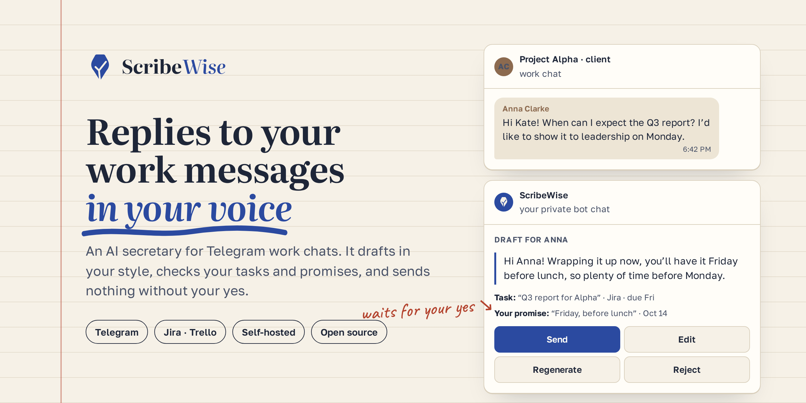
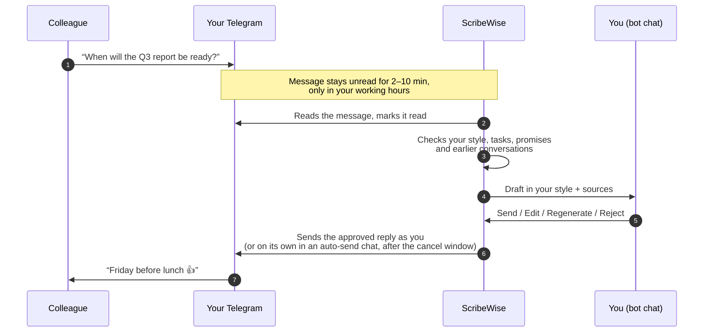

<p align="center">
  <picture>
    <source media="(prefers-color-scheme: dark)" srcset="brand/logo/lockup-inverse.svg">
    
  </picture>
</p>

<h3 align="center">Replies to your work messages in your own voice.</h3>

<p align="center">
  An AI secretary for Telegram work chats. It drafts replies in your style, checks your tasks
  and promises, and sends only what you approved or what you let it send in a chat you trust.
</p>

<p align="center">
  <a href="https://github.com/peach098/scribewise/actions/workflows/ci.yml"></a>
  
  
  
  
</p>

<p align="center">
  <a href="https://scribewise.dev/">Website</a> ·
  <a href="#key-features">Features</a> ·
  <a href="#how-it-works">How it works</a> ·
  <a href="#quick-setup">Self-host</a> ·
  <a href="docs/README.md">Docs</a> ·
  <a href="README.ru.md">Русский</a>
</p>

<p align="center">
  
</p>

## Why ScribeWise

If your work lives in Telegram, you know the drill: 50–200 messages a day, half of them “when
will it be ready?”, “did you take a look?”, “can we jump on a call?”. You answer them after
hours, and sooner or later you promise the same Friday to two people.

ChatGPT can write a reply, but everyone can tell it wasn’t you. Telegram auto-responders reply on
their own, from a script. ScribeWise does neither: it learns how *you* write, checks what you’ve
already promised, and waits for your yes before anything goes out (unless you turned on
auto-send for a chat).

> ScribeWise is the working name; the code and the bot are called Scribe.

## Key features

### ✍️ Sounds like you, not like ChatGPT
- **Learns your style** from six months of your own messages: tone, length, greetings, language.
- **A style per person.** Up to 20 profiles for your most active contacts and groups, so your
  manager gets “Good morning, Robert” and your teammate gets “ok, will look :)”. Pin the ones
  that matter.
- **Gets your grammar right.** Drafts use your grammatical gender (“I was/I’ve done” forms
  matter in Russian); Scribe asks once and you can change it in `/settings`.
- **Reads the room.** When a message is unusually formal or urgent, the draft shifts tone and
  keeps your habits.
- **Learns from your edits.** If you keep fixing the same thing, it proposes a new style rule;
  nothing changes until you accept. A weekly refresh tells you what changed, with one-tap undo.

### ✅ You stay in control
- **Nothing goes out unless you approved it, or you opted in.** By default every draft lands in
  your private bot chat with **Send**, **Edit**, **Regenerate** and **Reject**, and nothing is
  sent until you tap. Auto-send is off everywhere and turns on only per chat, after you confirm
  it for that chat (Scribe may offer it once you keep sending a chat’s drafts unchanged). In such
  a chat an eligible draft is sent after a cancel window of 1–15 minutes (2 by default), and
  the card shows the time and a **Don’t send automatically** button. Drafts with a new promise,
  a sensitive topic, missing details, a suspicious message, a weak style profile or a warning
  always wait for you. `/settings` changes the window and turns auto-send off everywhere in one
  tap.
- **Sent as you.** Approved replies go from your own account as ordinary messages, with no
  “sent by a bot” tag.
- **No forgotten drafts.** One reminder after 2 hours; after 24 hours the draft expires and the
  message is marked for you to handle.
- **Guards against prompt injection.** A message that reads like orders to the assistant is
  flagged on the card, and that draft can’t go out without your explicit confirmation.
- **Chats stay visible.** After the agent reads new messages in a work chat, or sends a reply
  you approved, the chat is marked unread again so your chat list still shows where something
  happened. The mark goes away when you open the chat and is not set again until something new
  arrives; turn it off in `/settings`.
- **Away?** `/pause` stops drafting (messages stay unread), and `/ooo` turns drafts into
  out-of-office replies based on your note.

### 🧠 Knows your context
- **Your tasks.** Reads Jira (Cloud and Data Center) and Trello, read-only, so “when will it be
  ready?” gets the real deadline.
- **Your promises.** Tracks what you committed to, to whom and by when, in chats and in your Jira
  comments (`/commitments`). Drafts that commit you to something new are flagged, and the card
  warns **📅 Dates differ** when a due date and your promise disagree.
- **Your history.** When someone says “as we agreed”, it searches your earlier conversations with
  that person and cites what it used.
- **No made-up facts.** If the answer isn’t in your context, the draft leaves a `[[…]]`
  placeholder for you to fill instead of inventing one.

### 🕰️ Human timing
- Messages stay **unread** for a random delay from your range (2–10 minutes by default), only
  during your working hours and days, in your time zone.
- A burst of messages from one person becomes **one draft**.
- **Skips what needs no reply.** “Thanks!”, “ok” and forwarded messages get no draft, unless
  you usually answer such messages in that chat. `/skipped` lists them with **Draft anyway**.
- **Groups without the noise.** In group chats a draft appears only when you are mentioned or
  someone replies to your message.
- `/waiting` shows which messages are still waiting to be read.

### 🔒 Private by design
- **Only the chats you choose** are read and stored. Everything else is never touched.
- **Encrypted at rest** with your own master key and **deleted after 30 days**.
- **Your data, your call:** `/my_data` shows and exports what is stored, `/delete_my_data` wipes
  it and logs out, and `/history` shows activity without message content.
- **QR-code login:** connect without sharing your phone number or a login code.
- **Self-hosted** in Docker, with your own model keys. Pick the provider per task: Anthropic or any
  OpenAI-compatible API. Startup refuses a provider you haven’t confirmed doesn’t train on your
  data.
- **English and Russian** bot interface.

## How it works



1. **Connect Telegram** with a QR code. ScribeWise signs in as one more of your devices.
2. **Pick your work chats.** It reads only those. Or turn on **work account mode**: every
   private chat with a person is a work chat, minus the ones you exclude.
3. **It learns your style** from your last six months of messages.
4. **Approve drafts** in your private bot chat with one tap.

## How it compares

| | **ScribeWise** | Telegram’s built-in AI<br><sub>Chat Automation, AI Styles</sub> | Auto-responders<br><sub>Chat Data, Smartbot, SendPulse</sub> | Email assistants<br><sub>Fyxer, Superhuman, Inbox Zero</sub> |
| --- | :---: | :---: | :---: | :---: |
| Style learned from your own messages | ✅ | you describe a style | rarely | ✅ |
| Knows your tasks and promises | ✅ | — | knowledge base only | — |
| Nothing sent unless you approve it or opt in per chat | ✅ | — the bot replies | — the bot replies | ✅ |
| Auto-send where you trust it | ✅ per chat, with a cancel window | ✅ | ✅ | — |
| Works in Telegram work chats | ✅ | ✅ | ✅ | — |
| Runs on your own server | ✅ | — | — | Inbox Zero only |

<sub>Competitor data from the products’ websites as of October 20, 2026.</sub>

## Roadmap

- 🔜 **Hosted version**: no Docker and no API keys, with personal help during the beta

## Quick setup

### 1. Prerequisites

- Docker + Docker Compose (Python 3.12 and [uv](https://docs.astral.sh/uv/) only to run
  outside Docker)
- A bot token from [@BotFather](https://t.me/BotFather) (this is your review chat)
  Optional: turn on inline mode there (`/setinline`, any placeholder) so ✏️ Edit can put a
  short draft straight into the input field; without it the draft is offered for copying.
- Telegram API id and hash from [my.telegram.org](https://my.telegram.org) → API development tools.
  Set the app title to **Scribe Agent** there, so the session is easy to recognise in
  Telegram's "Active sessions".
- An [Anthropic API key](https://console.anthropic.com/), or any OpenAI-compatible API
  (see [Choosing models](docs/self-hosting.md#choosing-models))

### 2. Configure

```bash
cp .env.example .env
openssl rand -base64 32        # paste the output as SCRIBE_MASTER_KEY
```

Fill in `SCRIBE_BOT_TOKEN`, `SCRIBE_TG_API_ID`, `SCRIBE_TG_API_HASH` and `ANTHROPIC_API_KEY`.
Keep `SCRIBE_MASTER_KEY` safe and backed up: it encrypts stored data, and losing it makes
the database unreadable. To replace it, follow
[Rotating the master key](docs/configuration.md#rotating-the-master-key).

> **Keep the bot private.** Scribe refuses to start (exit code 2) while the access gate is off,
> unless you set `SCRIBE_OPEN_BOT=true` on purpose, which lets anyone who finds the bot use it
> with your LLM key. `.env.example` turns the gate on: put your numeric Telegram id into
> `SCRIBE_OPERATOR_TELEGRAM_IDS` in `.env` so the bot lets you in
> ([details](docs/self-hosting.md#keep-your-bot-private)).

For a quick first try, turn off the reading delay so drafts appear right away:

```bash
echo 'SCRIBE_DELAY_MIN_S=0' >> .env
echo 'SCRIBE_DELAY_MAX_S=0' >> .env
```

### 3. Run

```bash
docker compose up -d db
docker compose run --rm app alembic upgrade head
docker compose up -d --build app
```

To run the app outside Docker, see
[Running outside Docker](docs/self-hosting.md#running-outside-docker).

Run one instance per database: a second `python -m scribe` against the same database exits
with code 1 ("another instance is already running") without starting anything.

Check it is up: `curl localhost:8080/healthz`. If port 5432 or 8080 is taken, set
`SCRIBE_DB_HOST_PORT` / `SCRIBE_HEALTH_HOST_PORT` in `.env` and use those ports above.

### 4. Connect your account

Open your bot in Telegram and send `/start`, then choose how to connect:

- **📷 Scan a QR code (recommended):** open Telegram on another device where you're signed
  in, go to Settings → Devices → Link Desktop Device and scan the code shown in the bot
  chat. You don't share your phone number or a login code. The code refreshes every ~30
  seconds, up to 5 times.
- **📱 Phone number and code:** enter your phone number, then the login code Telegram sends
  you **with spaces between the digits** (`1 2 3 4 5`) — Telegram blocks codes forwarded
  as-is.

Then:

1. Enter your 2FA password if you have one (with either method). The message is deleted
   right away and never stored.
2. Check the "✅ Connected as …" line. If it's the wrong account, press
   **This is not my account** and connect again.
3. Pick the work chats Scribe should handle, then press **Done**.
4. Wait for **All set** while it learns your style from your last 6 months of messages.

If the connection ends later (for example you terminate the session in Telegram), the bot
tells you; use `/telegram` → **Reconnect** with either method. Your settings, chats and
style profiles are kept.

When someone writes in an enabled chat, a draft card appears in the bot chat:
**✅ Send**, **✏️ Edit**, **🔁 Regenerate** or **❌ Reject**.

### 5. Connect Jira (optional)

Send `/tasks` → **🔌 Connect Jira** and pick where your Jira runs. Scribe only reads Jira; it
never creates, edits or comments on anything.

- **Jira Cloud** (`https://<team>.atlassian.net`): create a *scoped* API token at
  [id.atlassian.com → Security → API tokens](https://id.atlassian.com/manage-profile/security/api-tokens)
  → **Create API token with scopes** → Jira → `read:jira-work` and `read:jira-user`. Send the
  site address, your account email, then the token. Classic (unscoped) tokens are refused.
- **Self-hosted Jira** (Data Center / Server 10.3 or newer): create a personal access token
  (your avatar → Profile → Personal Access Tokens). Jira gives such a token all your
  permissions, so Scribe enforces read-only itself. Revoke the token in the same place to cut
  access. The server must be reachable from where Scribe runs. If it uses a certificate your
  company issued itself, the bot shows the certificate's fingerprint once; trust it only if it
  matches what your IT team expects. Scribe stops connecting if the certificate later changes.

The token message is deleted right away. Then pick up to 20 projects. Drafts use your open
issues assigned to you, including deadlines agreed in comments. Scribe also reads your own
comments on issues you're assigned to, reported or watch, and lists the promises it finds in
`/commitments` with a link to the comment. Keep Jira's automatic watching on, so the issues you
comment on are found. When an issue's due date and your promise disagree, the draft card shows
**📅 Dates differ**.

Trello works the same way: `/tasks` → **🔌 Connect Trello**. One tracker can be connected at
a time.

Working hours default to 09:00–19:00, Monday–Friday, in the time zone you pick during setup.
Change them, the reading delay, the time zone and the bot language with `/settings`. All
commands are listed in [docs/commands.md](docs/commands.md).

To update later, see [Upgrading](docs/self-hosting.md#upgrading): migrations are not applied
automatically.

## Documentation

- [Self-hosting guide](docs/self-hosting.md): install, models and providers, upgrades, backups, troubleshooting
- [Commands](docs/commands.md): bot commands and the operator CLI
- [Configuration](docs/configuration.md): every setting with its default
- [Privacy and data](docs/privacy.md): what is stored, for how long, and what goes to the model
- [Architecture](docs/architecture.md): how a message becomes a draft, the code map
- [Search over earlier conversations](docs/earlier-search.md)
- [Access gate](docs/access-gate.md): beta invitations and subscriptions for a hosted instance
- [Release notes and releases](docs/release-notes.md)
- [Publishing the landing page](docs/deploy-s3.md) (in Russian)

### Brand

The logo, colors and usage rules are in [`brand/logo`](brand/logo/README.md). The landing page
source is in [`landing/`](landing/) (Russian and English, static HTML).

## Contributing

Bug reports, ideas and pull requests are welcome; start with [CONTRIBUTING.md](CONTRIBUTING.md).
Please report security problems privately, as described in [SECURITY.md](SECURITY.md).

```bash
uv sync
make lint typecheck      # ruff + mypy
make test-fast           # unit + contract tests, no database
make test-integration    # needs Docker (starts Postgres via testcontainers)
make eval-dry            # eval runner with canned outputs, no API calls
make eval                # real eval against the configured models (costs money; in CI only by hand: the "Evaluation set" workflow)
```

Every feature is designed in [`specs/`](specs/) (spec, plan, data model, contracts, manual
test walkthrough) before it is built, under the rules in the
[constitution](.specify/memory/constitution.md).

## License

Scribe is source-available under the [Apache License 2.0](LICENSE) with the
[Commons Clause](https://commonsclause.com/) condition: you may use, modify and share it
(including for your own work), but you may not sell it — that is, offer for a fee a
product or service (hosting, support, etc.) whose value comes mainly from Scribe.
See [LICENSE](LICENSE) for the full terms.
