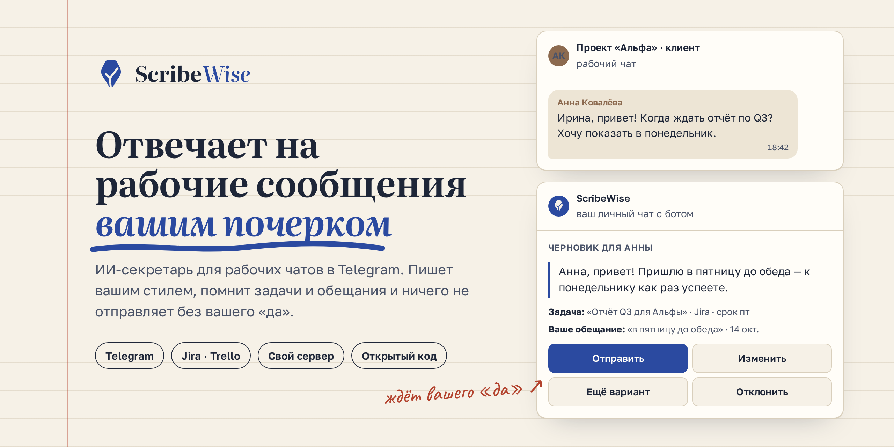
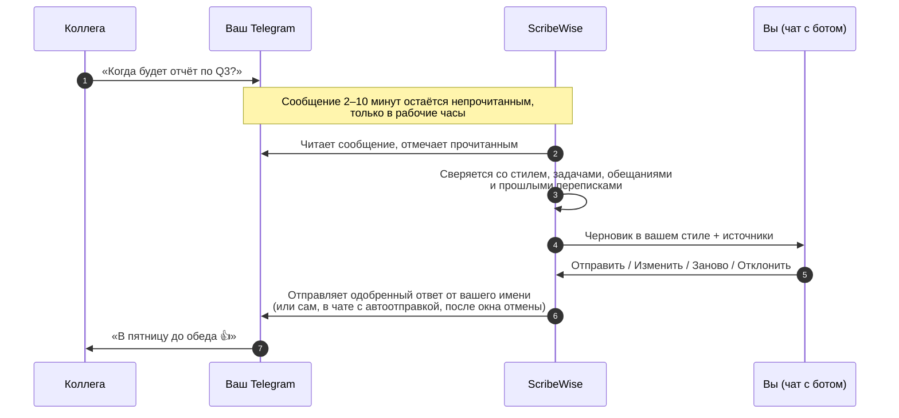

<p align="center">
  <picture>
    <source media="(prefers-color-scheme: dark)" srcset="brand/logo/lockup-inverse.svg">
    
  </picture>
</p>

<h3 align="center">Отвечает на рабочие сообщения вашим почерком.</h3>

<p align="center">
  ИИ-секретарь для рабочих чатов в Telegram. Пишет черновики вашим стилем, сверяется с задачами
  и обещаниями и отправляет только то, что вы одобрили или разрешили отправлять самому в доверенном чате.
</p>

<p align="center">
  <a href="https://github.com/peach098/scribewise/actions/workflows/ci.yml"></a>
  
  
  
  
</p>

<p align="center">
  <a href="https://scribewise.dev/ru/">Сайт</a> ·
  <a href="#возможности">Возможности</a> ·
  <a href="#как-это-работает">Как это работает</a> ·
  <a href="#быстрая-установка">Установка</a> ·
  <a href="docs/README.md">Документация</a> ·
  <a href="README.md">English</a>
</p>

<p align="center">
  
</p>

## Зачем ScribeWise

Если ваша работа живёт в Telegram, картина знакомая: 50–200 сообщений в день, и половина из них —
«когда будет?», «посмотрел?», «созвонимся?». Вы отвечаете на них вечером, а рано или поздно
обещаете одну и ту же пятницу двум людям.

ChatGPT может написать ответ, но собеседник сразу поймёт, что писали не вы. Автоответчики в
Telegram отвечают сами и по шаблону. ScribeWise не делает ни того, ни другого: он учится тому, как
пишете *вы*, проверяет, что вы уже пообещали, и ждёт вашего «да», прежде чем что-то отправить (если вы не включили автоотправку для чата).

> ScribeWise — рабочее название; в коде и в боте продукт называется Scribe.

## Возможности

### ✍️ Звучит как вы, а не как ChatGPT
- **Учится вашему стилю** по вашим сообщениям за полгода: тон, длина, обращения, язык.
- **Свой стиль для каждого.** До 20 профилей для самых активных собеседников и групп: начальнику —
  «Добрый день, Сергей Петрович», коллеге — «ок, гляну)». Важные контакты можно закрепить.
- **Правильный род.** Черновики пишутся в вашем грамматическом роде («сделал» или «сделала»):
  агент один раз спросит, а поменять можно в `/settings`.
- **Чувствует тон.** Если сообщение необычно официальное или срочное, черновик подстраивается и
  сохраняет ваши привычные обороты.
- **Учится на ваших правках.** Если вы раз за разом исправляете одно и то же, агент предложит новое
  правило стиля; без вашего согласия ничего не меняется. Раз в неделю профиль обновляется, а бот
  показывает, что изменилось, и даёт отменить одной кнопкой.

### ✅ Последнее слово за вами
- **Без вашего одобрения или вашего разрешения ничего не уходит.** По умолчанию каждый черновик
  приходит в личный чат с ботом с кнопками **Отправить**, **Изменить**, **Заново** и
  **Отклонить**, и пока вы не нажмёте, ничего не отправляется. Автоотправка везде выключена и
  включается только для отдельного чата после вашего подтверждения (бот может сам предложить её,
  когда вы стабильно отправляете черновики этого чата без правок). В таком чате подходящий
  черновик уходит после окна отмены от 1 до 15 минут (по умолчанию 2), а на карточке видны время
  и кнопка **Не отправлять автоматически**. Черновики с новым обещанием, чувствительной темой,
  пропущенными деталями, подозрительным сообщением, слабым профилем стиля или предупреждением
  всегда ждут вас. В `/settings` можно изменить окно и выключить автоотправку везде одним
  нажатием.
- **От вашего имени.** Одобренный ответ уходит с вашего аккаунта как обычное сообщение, без
  пометки «отправлено ботом».
- **Черновики не теряются.** Через 2 часа бот напомнит о черновике один раз, через 24 часа черновик
  истекает, а сообщение помечается для ответа вручную.
- **Защита от prompt injection.** Если сообщение похоже на команды ассистенту, карточка это
  показывает, и такой черновик нельзя отправить без вашего явного подтверждения.
- **Чаты не теряются в списке.** Когда агент прочитал новые сообщения в рабочем чате или отправил
  одобренный вами ответ, чат снова отмечается непрочитанным, и в списке чатов видно, где что-то
  произошло. Отметка исчезает, когда вы открываете чат, и не возвращается, пока не придёт что-то
  новое; отключается в `/settings`.
- **Уходите?** `/pause` останавливает черновики (сообщения остаются непрочитанными), а `/ooo`
  готовит ответы «меня нет на месте» по вашему тексту.

### 🧠 Знает контекст
- **Ваши задачи.** Читает Jira (Cloud и Data Center) и Trello, только на чтение, поэтому на «когда
  будет?» отвечает реальным сроком.
- **Ваши обещания.** Запоминает, что, кому и к какому сроку вы пообещали — в чатах и в своих
  комментариях в Jira (`/commitments`). Черновики, которые берут на вас новое обязательство,
  помечаются, а если срок задачи и ваше обещание не совпадают, карточка покажет
  **📅 Даты расходятся**.
- **Ваша история.** Когда собеседник пишет «как договаривались», агент ищет в ваших прошлых
  переписках с этим человеком и показывает, на что опирался.
- **Без выдумок.** Если ответа нет в контексте, в черновике остаётся пропуск `[[…]]`, который вы
  заполните сами, а не придуманный факт.

### 🕰️ Человеческий тайминг
- Сообщения остаются **непрочитанными** случайное время из вашего диапазона (по умолчанию 2–10
  минут) и только в ваши рабочие часы и дни, в вашем часовом поясе.
- Несколько сообщений подряд от одного человека — **один черновик**.
- **Не отвечает там, где не нужно.** На «спасибо!», «ок» и пересланные сообщения черновик не
  готовится, если только вы обычно не отвечаете на такие сообщения в этом чате. `/skipped`
  показывает их с кнопкой **✍️ Всё равно черновик**.
- **Группы без шума.** В групповых чатах черновик появляется, только когда вас упомянули или
  ответили на ваше сообщение.
- `/waiting` показывает, какие сообщения ещё ждут прочтения.

### 🔒 Приватность по умолчанию
- **Только выбранные чаты** читаются и сохраняются. Остальные агент не трогает.
- **Шифрование** вашим собственным мастер-ключом и **удаление через 30 дней**.
- **Данные под вашим контролем:** `/my_data` показывает и выгружает то, что хранится,
  `/delete_my_data` удаляет всё и отключает агента, `/history` показывает действия без текста
  сообщений.
- **Вход по QR-коду:** без номера телефона и кода из СМС.
- **На своём сервере** в Docker, со своими ключами к моделям. Провайдера можно выбрать для каждой
  задачи: Anthropic или любой OpenAI-совместимый API. Провайдера, про которого вы не подтвердили,
  что он не обучается на ваших данных, приложение не запустит.
- **Русский и английский** интерфейс бота.

## Как это работает



1. **Подключите Telegram** по QR-коду. ScribeWise войдёт как ещё одно ваше устройство.
2. **Отметьте рабочие чаты.** Агент читает только их. Или включите **режим рабочего
   аккаунта**: каждый личный чат с человеком — рабочий, кроме исключённых вами.
3. **Агент изучит ваш стиль** по сообщениям за последние полгода.
4. **Одобряйте черновики** в личном чате с ботом одной кнопкой.

## Сравнение

| | **ScribeWise** | Встроенный ИИ Telegram<br><sub>Chat Automation, AI Styles</sub> | Автоответчики<br><sub>Chat Data, Smartbot, SendPulse</sub> | Почтовые ассистенты<br><sub>Fyxer, Superhuman, Inbox Zero</sub> |
| --- | :---: | :---: | :---: | :---: |
| Стиль, выученный по вашей переписке | ✅ | стиль задаёте подсказкой | редко | ✅ |
| Знает ваши задачи и обещания | ✅ | — | только база знаний | — |
| Ничего не отправляет без одобрения или вашего разрешения для чата | ✅ | — бот отвечает сам | — бот отвечает сам | ✅ |
| Автоотправка там, где вы доверяете | ✅ по чатам, с окном отмены | ✅ | ✅ | — |
| Работает в рабочих чатах Telegram | ✅ | ✅ | ✅ | — |
| Можно развернуть на своём сервере | ✅ | — | — | только Inbox Zero |

<sub>Данные о конкурентах — с сайтов продуктов на 20 октября 2026 года.</sub>

## Планы

- 🔜 **Облачная версия**: без Docker и API-ключей, с личной помощью в настройке во время беты

## Быстрая установка

### 1. Что понадобится

- Docker и Docker Compose (Python 3.12 и [uv](https://docs.astral.sh/uv/) — только для запуска
  без Docker)
- Токен бота от [@BotFather](https://t.me/BotFather) — в этом чате вы будете получать черновики.
  Можно включить там inline-режим (`/setinline`, текст подсказки любой): тогда ✏️ Изменить
  подставит короткий черновик прямо в поле ввода, а без него черновик предлагается скопировать.
- API id и hash Telegram на [my.telegram.org](https://my.telegram.org) → API development tools.
  Назовите приложение **Scribe Agent**, чтобы сессию было легко узнать в «Активных сеансах»
  Telegram.
- [Ключ Anthropic API](https://console.anthropic.com/) или любой OpenAI-совместимый API
  (см. [выбор моделей](docs/self-hosting.md#choosing-models), на английском)

### 2. Настройка

```bash
cp .env.example .env
openssl rand -base64 32        # вставьте результат в SCRIBE_MASTER_KEY
```

Заполните `SCRIBE_BOT_TOKEN`, `SCRIBE_TG_API_ID`, `SCRIBE_TG_API_HASH` и `ANTHROPIC_API_KEY`.
Храните `SCRIBE_MASTER_KEY` надёжно и сделайте его резервную копию: им шифруются сохранённые
данные, и без него базу не прочитать. Как заменить ключ:
[Rotating the master key](docs/configuration.md#rotating-the-master-key).

> **Закройте бота от посторонних.** Scribe не запустится (код выхода 2), пока доступ по списку
> выключен, если только вы сознательно не зададите `SCRIBE_OPEN_BOT=true` — тогда бот открыт
> всем, кто его найдёт, за счёт вашего ключа LLM. В `.env.example` доступ по списку включён:
> впишите свой числовой Telegram id в `SCRIBE_OPERATOR_TELEGRAM_IDS` в `.env`, чтобы бот пускал
> вас ([подробнее](docs/self-hosting.md#keep-your-bot-private)).

Для первой пробы отключите задержку чтения, чтобы черновики появлялись сразу:

```bash
echo 'SCRIBE_DELAY_MIN_S=0' >> .env
echo 'SCRIBE_DELAY_MAX_S=0' >> .env
```

### 3. Запуск

```bash
docker compose up -d db
docker compose run --rm app alembic upgrade head
docker compose up -d --build app
```

Как запустить приложение без Docker, описано в
[Running outside Docker](docs/self-hosting.md#running-outside-docker).

На одну базу — один экземпляр: второй `python -m scribe` с той же базой завершится с кодом 1
(«another instance is already running»), ничего не запустив.

Проверка: `curl localhost:8080/healthz`. Если порт 5432 или 8080 занят, задайте
`SCRIBE_DB_HOST_PORT` / `SCRIBE_HEALTH_HOST_PORT` в `.env` и используйте эти порты.

### 4. Подключите аккаунт

Откройте своего бота в Telegram, отправьте `/start` и выберите способ подключения:

- **📷 Сканировать QR-код (рекомендуется):** откройте Telegram на другом устройстве, где вы уже
  вошли, перейдите в Настройки → Устройства → Подключить устройство и отсканируйте код из чата с
  ботом. Номер телефона и код входа не нужны. Код обновляется примерно каждые 30 секунд, до 5 раз.
- **📱 Номер телефона и код:** введите номер, затем код, который пришлёт Telegram, **с пробелами
  между цифрами** (`1 2 3 4 5`) — пересланные как есть коды Telegram блокирует.

Дальше:

1. Если включена двухэтапная аутентификация, введите пароль (при любом способе). Сообщение с ним
   сразу удаляется и нигде не хранится.
2. Проверьте строку «✅ Подключён аккаунт …». Если аккаунт не тот, нажмите **Это не мой аккаунт** и
   подключитесь заново.
3. Отметьте рабочие чаты, которые будет вести Scribe, и нажмите **Готово**.
4. Дождитесь сообщения **✅ Готово!** — пока агент изучает ваш стиль по сообщениям за последние
   полгода.

Если подключение потом оборвётся (например, вы завершите сеанс в Telegram), бот сообщит об этом;
подключитесь снова через `/telegram` → **Переподключить** любым способом. Настройки, чаты и
профили стиля сохранятся.

Когда вам напишут в рабочем чате, в чате с ботом появится карточка черновика:
**✅ Отправить**, **✏️ Изменить**, **🔁 Заново** или **❌ Отклонить**.

### 5. Подключите Jira (по желанию)

Отправьте `/tasks` → **🔌 Подключить Jira** и выберите, где работает ваша Jira. Scribe только
читает Jira: ничего не создаёт, не меняет и не комментирует.

- **Jira Cloud** (`https://<команда>.atlassian.net`): создайте API-токен *с ограниченными правами* на
  [id.atlassian.com → Security → API tokens](https://id.atlassian.com/manage-profile/security/api-tokens)
  → **Create API token with scopes** → Jira → `read:jira-work` и `read:jira-user`. Отправьте боту
  адрес сайта, email аккаунта, затем токен. Классические токены без ограничений не принимаются.
- **Jira на своём сервере** (Data Center / Server 10.3 или новее): создайте персональный токен
  доступа (аватар → Профиль → Personal Access Tokens). Такой токен получает все ваши права, поэтому
  режим «только чтение» Scribe обеспечивает сам. Отозвать токен можно там же. Сервер должен быть
  доступен оттуда, где работает Scribe. Если на нём сертификат, выпущенный вашей компанией, бот
  один раз покажет его отпечаток: доверяйте ему, только если он совпадает с тем, что ожидает ваш
  ИТ-отдел. Если сертификат потом сменится, Scribe перестанет подключаться.

Сообщение с токеном сразу удаляется. Затем выберите до 20 проектов. Черновики учитывают ваши
открытые задачи, назначенные на вас, включая сроки, согласованные в комментариях. Scribe также
читает ваши комментарии в задачах, где вы исполнитель, автор или наблюдатель, и выводит найденные
обещания в `/commitments` со ссылкой на комментарий. Не отключайте автоматическое наблюдение в Jira,
чтобы задачи, которые вы комментируете, находились. Если срок задачи и ваше обещание расходятся,
карточка черновика покажет **📅 Даты расходятся**.

Trello подключается так же: `/tasks` → **🔌 Подключить Trello**. Одновременно подключается
один трекер.

По умолчанию рабочие часы — 09:00–19:00, понедельник–пятница, в часовом поясе, который вы
выберете при настройке. Их, задержку чтения, часовой пояс и язык бота можно поменять в
`/settings`. Все команды — в [docs/commands.md](docs/commands.md).

Как обновляться, описано в [Upgrading](docs/self-hosting.md#upgrading): миграции сами не
применяются.

## Документация

Подробные документы на английском:

- [Руководство по установке](docs/self-hosting.md): установка, модели и провайдеры, обновление, резервные копии, решение проблем
- [Команды](docs/commands.md): команды бота и админ-команды
- [Настройки](docs/configuration.md): все параметры и их значения по умолчанию
- [Приватность и данные](docs/privacy.md): что хранится, сколько и что уходит в модель
- [Архитектура](docs/architecture.md): как сообщение становится черновиком, карта кода
- [Поиск по прошлым перепискам](docs/earlier-search.md)
- [Доступ на облачном инстансе](docs/access-gate.md): приглашения в бету и подписки
- [Что нового после обновления и выпуск версий](docs/release-notes.md)
- [Публикация лендинга](docs/deploy-s3.md) (на русском)

### Бренд

Логотип, цвета и правила использования — в [`brand/logo`](brand/logo/README.md). Исходники лендинга —
в [`landing/`](landing/) (русская и английская версии, статический HTML).

## Участие в разработке

Сообщения об ошибках, идеи и pull request'ы приветствуются; начните с
[CONTRIBUTING.md](CONTRIBUTING.md). Issues и pull request'ы пишутся на английском. Об уязвимостях
сообщайте не в issues, а закрыто, как описано в [SECURITY.md](SECURITY.md).

```bash
uv sync
make lint typecheck      # ruff + mypy
make test-fast           # юнит- и контрактные тесты, без базы
make test-integration    # нужен Docker (Postgres через testcontainers)
make eval-dry            # прогон оценки на заготовленных ответах, без вызовов API
make eval                # настоящая оценка на настроенных моделях (стоит денег; в CI только вручную: workflow «Evaluation set»)
```

Каждая функция сначала проектируется в [`specs/`](specs/) (спецификация, план, модель данных,
контракты, сценарий ручной проверки) по правилам из [конституции](.specify/memory/constitution.md).

## Лицензия

Код Scribe открыт (source-available) и распространяется по [Apache License 2.0](LICENSE) с условием
[Commons Clause](https://commonsclause.com/): его можно использовать, менять и распространять (в том
числе для своей работы), но нельзя продавать — то есть предлагать за плату продукт или услугу
(хостинг, поддержку и т. п.), ценность которых в основном составляет Scribe. Полные условия — в
[LICENSE](LICENSE).
