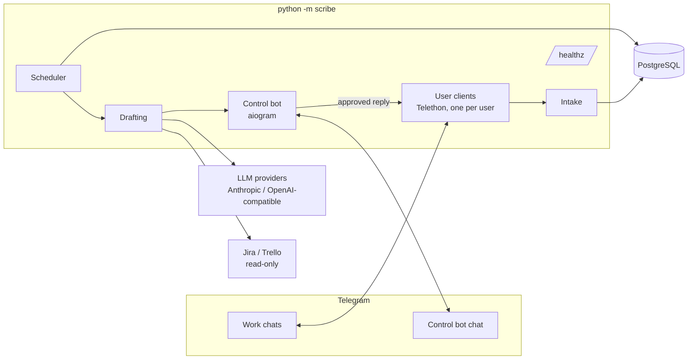

# Architecture

Scribe is one Python process (`python -m scribe`) and one PostgreSQL database. There is no
public API and no web UI: users talk to Scribe through a Telegram bot (the *control bot*),
and Scribe reads and sends work messages through each user's own Telegram account.

## The life of a message

1. **Intake** (`intake/router.py`). A user client receives a new message. If the chat is not
   an enabled work chat, it is dropped before anything is stored. Otherwise the message is
   stored encrypted and becomes part of a *turn*: a burst of messages from one person that
   will get one draft. In groups a turn is created only when the user is mentioned or replied
   to. Forwarded messages are kept as context, not as the contact's own words.
2. **Waiting** (`scheduling/`). The turn gets a due time: a random delay from the user's range,
   moved into their working hours and days. Until then the message stays unread.
3. **Reading** (`scheduling/scheduler.py`). The scheduler polls Postgres every few seconds
   (`SELECT … FOR UPDATE SKIP LOCKED`), marks due messages read and decides whether a reply is
   needed at all (`drafting/reply_gate.py`); closing messages like "thanks!", messages that
   only inform, and messages one of the user's rules says to skip are skipped and
   listed in `/skipped`.
4. **Drafting** (`drafting/composer.py`). The composer collects context: recent history, open
   tasks from Jira or Trello, open commitments, and, when the message refers to something
   older, a search over earlier conversations (`context/earlier.py`). A cheap model filters
   it, then the drafting model writes the reply in the style profile for that contact
   (`style/`). Facts not found in the context become `[[…]]` placeholders. Messages that look
   like instructions to the assistant are flagged (`drafting/injection.py`).
5. **Review** (`telegram/control_bot/review.py`). The draft card goes to the user's control
   chat with **Send / Edit / Regenerate / Reject**, its sources and its flags. Unanswered
   cards get one reminder and then expire. In a chat the user turned auto-send on for, an
   eligible draft also gets a countdown, armed only after the card was posted, in the same
   transaction that stores its message id (`sending/auto_send.py`: `plan_arm`, `commit_arm`);
   the card shows the time and **⏹ Don't send automatically**.
6. **Auto-send** (`sending/auto_send.py`, scheduler step `on_auto_sends`). When a countdown
   ends, `AutoSender` locks the draft and checks eligibility again (`eligibility()`: no
   promise, sensitive topic, placeholder, injection stop, conflict or warning; chat on; inside
   working hours; not paused or out of office). Eligible drafts get `drafts.auto_approved_at`,
   which is never the user's `approved_by_user_at`, and go through the same send path as a
   tap; the others stop and their card says why. A tap and the countdown lock the same row, so
   exactly one of them wins. The user's decisions are kept as `draft_decisions` rows, which
   feed the per-chat offer to turn auto-send on and the suggestion to turn it off
   (`AutoSendAdvisor`).
7. **Sending** (`sending/send.py`). Only after the user approves, or after the cancel window of
   a chat the user opted in to, the reply is sent from their own account. The chat is marked
   unread again so the user still sees it in their list.

## Packages

| Package | What it does |
| --- | --- |
| `telegram/` | Telethon user clients (`client_pool.py`, `user_client.py`), QR and phone login (`login.py`), the gateway interface and its fake for tests |
| `telegram/control_bot/` | The aiogram bot: setup flow, commands, draft cards, settings |
| `intake/` | Which incoming messages are stored and how they group into turns |
| `scheduling/` | The Postgres-polling scheduler, working hours, review deadlines, the auto-send step |
| `sending/` | Sending an approved draft (`send.py`) and opt-in auto-send: eligibility, countdown, offer (`auto_send.py`) |
| `drafting/` | Reply gate, composer, placeholders, injection and promise checks, the daily LLM budget per user (`budget.py`) |
| `context/` | History, earlier-conversation search, commitments, task sources (`tasks/jira`, `tasks/trello`) |
| `style/` | Style profiles: import of the user's own messages, building, weekly refresh, rule proposals |
| `llm/` | The router that maps a logical route (`compose.draft`, …) to a provider and model, adapters, pricing |
| `access/` | Optional access gate for a hosted instance: beta list, subscriptions |
| `retention/` | Daily purge of expired content, re-encryption, `/my_data` export and deletion |
| `release_notes/` | "What's new" messages after an update |
| `db/` | SQLAlchemy models and repositories; migrations live in `alembic/versions/` |
| `i18n/` | Bot texts in English and Russian |
| `admin.py` | Operator CLI: `python -m scribe.admin …` |

## Design choices

- **One process, one database.** The scheduler stores its jobs in Postgres and uses
  `SKIP LOCKED`, so there is no Redis or queue to run.
- **Routes, not models.** Code asks for a route like `compose.draft`; `config/llm_routes.yml`
  decides the provider and model. Startup fails on an unknown provider, an unpriced model, or a
  provider not confirmed to keep data out of training.
- **Encryption in the application.** Sensitive columns are encrypted with AES-256-GCM before
  they reach the database (`crypto.py`), so a database dump alone is not readable. Each value is
  bound to its table and column, and the key can be rotated (`retention/reencrypt_all.py`).
- **One instance per database.** `python -m scribe` holds a Postgres advisory lock for its
  lifetime; a second instance exits instead of starting the same Telegram sessions twice.
- **Fakes at the edges.** Telegram, LLMs and task sources each have an interface with a fake
  implementation, so most tests run without network access.

## Specs

Every feature was designed with [Spec Kit](https://github.com/github/spec-kit) before it was
built. Each folder in [`specs/`](../specs/) holds the spec, research notes, data model,
contracts, a manual test walkthrough (`quickstart.md`) and the task list. The rules every
plan is checked against are in the [constitution](../.specify/memory/constitution.md).
